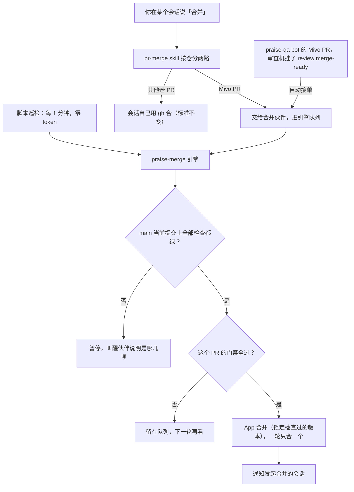

# 合并伙伴怎么工作

一页讲清合并伙伴现在的完整机制（2026-11-08）。命令、配置和事件细节见 [operations.md](operations.md)。

## 一句话

合并伙伴只合 Mivo 仓（`xindong/mivo-canvas-plugin`）的 PR。它每分钟看一次，main 上全部检查都绿才合，一次合一个。

## 谁合哪些 PR

- **Mivo 仓**：由合并伙伴合。别的仓交给伙伴会被拒收（`repo_not_in_policy`）。
- **其他仓**：你在哪个会话说「合并」，就由那个会话按 `pr-merge` skill 自己用 `gh` 合。条件是 CI 全绿、GitHub 显示能直接合、没有未解决的讨论、有当前这一版的 GPT 单审和 e2e。缺审查或 e2e 时，会话先派 Orca 补齐；合并前最后再把这些条件核一遍。

## PR 怎么进伙伴的队列

- **你说「合并」**：发起会话把 Mivo PR 连同先后顺序交给伙伴。授权 7 天有效。
- **bot PR 自动接单**：praise-qa bot 开的、指向 main、不是 Draft、带 `review:merge-ready` 标签的 PR，引擎每轮自己接，不用你说。这个标签最近一次必须是审查机 `praisebuild[bot]`（或你本人）挂的，别人手动挂的不认。标签被审查机摘掉，PR 就不合。

## 引擎每一轮做什么

1. **先看 main**：main 当前提交上的全部检查，按「写入的 App + 检查名」取最新一次。有一项失败或还在跑，就暂停，叫醒伙伴说明是哪几项。全部转绿后的下一轮（最多约 1 分钟）恢复。
2. **再看每个 PR**：必需检查全过（审查机的 `review-pr` 在当前版本上成功）、讨论全部解决、GitHub 显示可以合；bot PR 还要标签仍在且是审查机挂的。
3. **合并**：一轮只合一个，锁定检查过的那个版本。PR 落后 main 但 GitHub 允许直接合，就直接合，不先同步 main。合入后 main 会跑新的检查，要等它重新全绿才合下一个，所以大约 15–20 分钟一个。
4. **兜底**：合入时发现 main 在那一瞬间被别人推进了，就冻结车道，等人确认后 `unfreeze`。读 GitHub 失败时不接单、不合并，叫醒伙伴一次；同一原因再失败只记日志，恢复时再叫醒一次。

## 出事怎么知道

巡检只在有事时叫醒合并伙伴，伙伴再转告你：合入了哪个 PR、车道为什么暂停或恢复、自动接单出错或恢复、车道冻结、心跳中断。没事时安静，不花钱。

## 跑在哪

| 东西 | 在哪 |
|---|---|
| 引擎代码和配置 | Mini 上 `~/praise-merge-runtime/`，配置里只有 Mivo，并打开了自动接单 |
| 队列和日志 | Mini 上 `~/.local/state/praise-merge/` |
| 巡检 | Cindy 脚本调度 `12fe125a`，每 1 分钟跑 `scripts/cindy-tick.mjs`，零 token |
| 合并伙伴 | Cindy 伙伴「合并伙伴」，主力电脑 Mini；只在有事时被叫醒。原来的模型巡检已暂停，可随时恢复 |
| 合并身份 | GitHub App `praise-merge`，私钥只在 Mini 上 |

## 已知代价

- main 上任何一项检查一直不绿，包括非必需检查和 GitHub 自己的故障（比如下载 CodeQL 包 504），伙伴就一直停着，要有人去重跑或修好。
- 一次只合一个、合后等 main 全绿，所以排队的 PR 多时会慢。想更快只能开 GitHub 合并队列，或者放宽「main 全绿才合下一个」，两样都要用户拍板。
